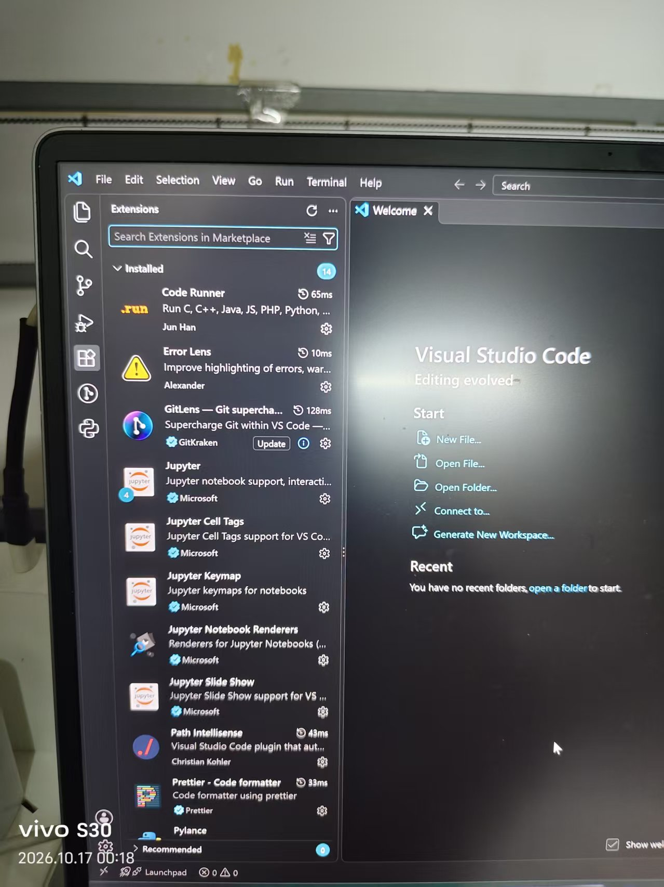
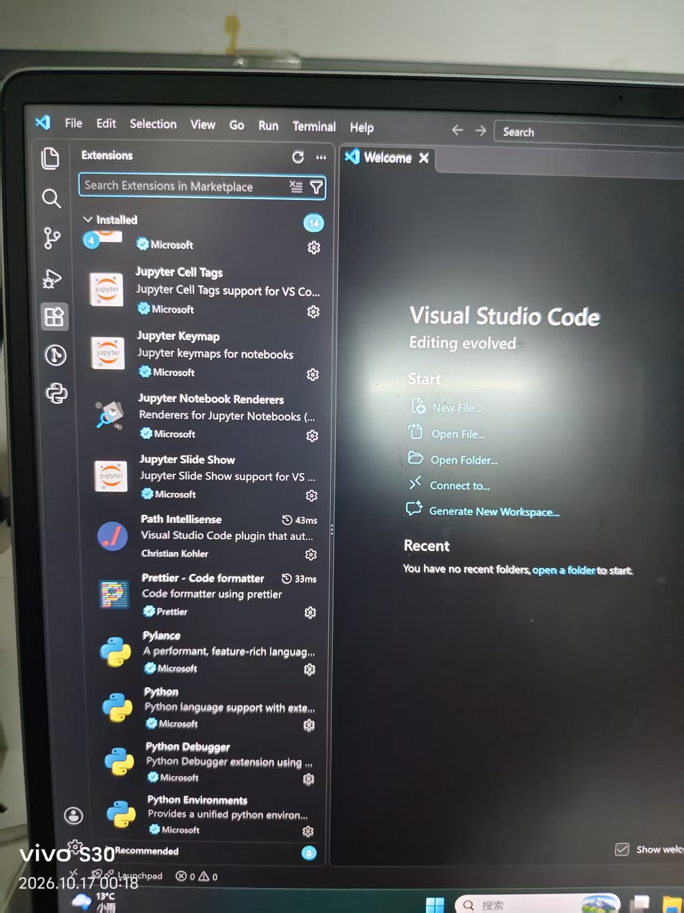
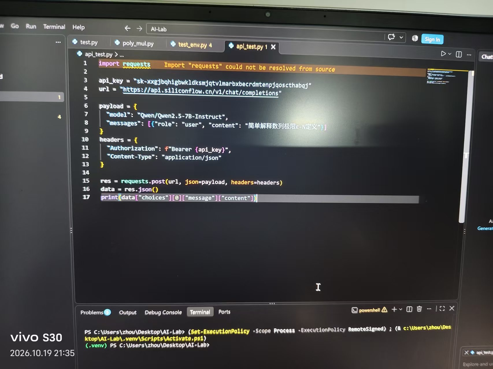

# Task01：AI编程环境搭建实践报告
> 姓名：[填写你的名字]
> 班级：数学2601
> 学号：[填写你的学号]
> 完成时间：2026-10-15

## 一、任务简介
本任务完成VS Code开发环境配置、Python虚拟环境搭建、DSH（DeepSeek Harness）网页服务部署，调用硅基流动API完成大模型交互，并且使用DSH对Python代码开展代码审查。
全部操作在太原理工大学明向校区线下完成。

## 二、开发环境信息
1. 编辑器：Visual Studio Code
2. 系统：Windows
3. Python版本：Python3.x，使用venv虚拟环境
4. 用到插件清单
- Code Runner：一键运行代码
- Error Lens：代码错误高亮提示
- GitLens：Git版本控制增强工具
- Path Intellisense：文件路径自动补全
- Prettier - Code formatter：代码格式化
- Python：Python语言基础支持
- Jupyter：Jupyter Notebook 交互支持

## 三、项目文件结构
```plaintext
Al-Lab/
├── README.md
├── api_test.py
└── screenshots/
    ├── vscode_env.jpg
    ├── dsh_terminal.jpg
    ├── api_success.jpg
    └── error_log.jpg
 
 
四、api_test.py 源代码
  
import requests

api_key = "sk-xxx"
url = "https://api.siliconflow.cn/v1/chat/completions"

payload = {
    "model": "Qwen/Qwen2.5-7B-Instruct",
    "messages": [
        {"role": "user", "content": "简单解释数列极限ε-N定义"}
    ]
}
headers = {
    "Authorization": f"Bearer {api_key}",
    "Content-Type": "application/json"
}

res = requests.post(url, json=payload, headers=headers)
data = res.json()
print(data["choices"][0]["message"]["content"])
 
五、操作流程
 
1. 安装VS Code，在扩展市场安装任务指定全部7个插件。
2. 创建Python虚拟环境venv，激活虚拟环境。
3. 编写api_test.py，调用硅基流动的API接口。
4. 启动DSH网页端，上传代码文件，执行代码审查：逐行分析代码，识别潜在风险，给出优化建议。
5. 在PowerShell终端运行api_test.py，成功获取大模型返回文本，验证API连通。
 
六、故障排查记录（Troubleshooting）
 
问题1：VS Code提示 import "requests" could not be resolved from source
 
现象：代码中import requests出现黄色警告波浪线，无法识别库。
原因：虚拟环境内没有安装requests第三方HTTP库。
解决方法：在激活的虚拟环境终端执行安装命令
  
pip install requests
 
 
安装完成后，VS Code可以正常识别requests包，警告消失。
 
问题2：早期API调用认证失败
 
现象：调用硅基流动API返回401鉴权错误，切换多个线路均无法连通。
原因：复制API密钥时，密钥前后带有不可见空格，导致密钥无效。
解决方法：复制密钥时去除首尾空格，核对密钥完整性。
 
问题3：DSH提示 dsh-sdk 包未找到
 
现象：PowerShell出现警告 Package(s) dsh not found: dsh-sdk 
原因：当前虚拟环境没有安装dsh-sdk包，仅网页端DSH可正常使用，不影响网页端代码审查功能。
解决：如需终端使用dsh命令，执行 pip install dsh-sdk ；网页交互模式可以忽略此警告。
 
 ## 七、截图展示
VSCode插件截图



DSH终端启动截图


DSH代码审查截图


API调用成功截图


requests报错截图

 
八、收获总结
 
本次任务完成了完整的Python开发环境搭建，学会使用VS Code配套插件辅助代码编写；掌握了硅基流动API的调用方法；使用DSH完成代码审查，学会从第三方视角寻找代码漏洞。
同时在排错过程中，理解虚拟环境的作用、Python第三方包安装方法，熟悉API鉴权、密钥安全的注意事项，为后续数学建模、数据分析相关编程打下基础。
 