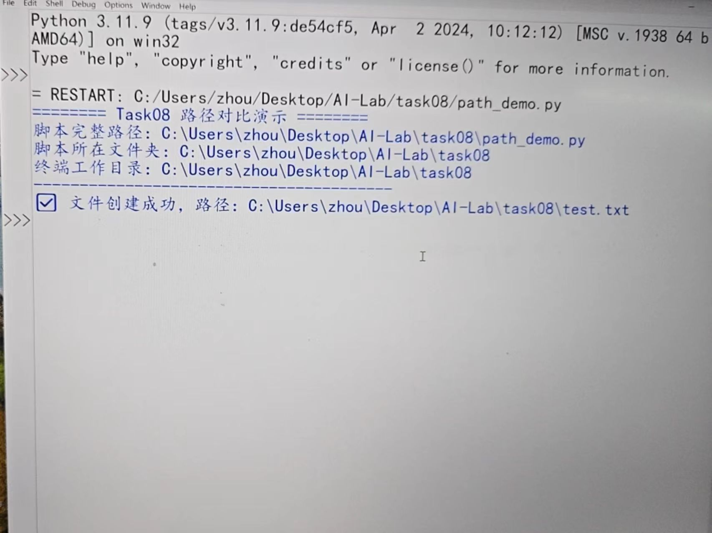
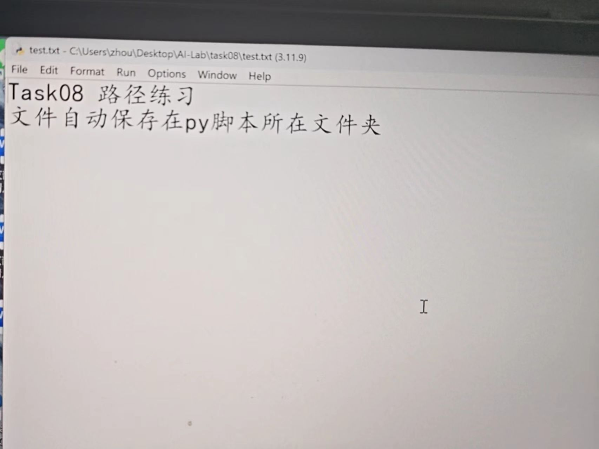

# Task08 文件路径处理
## 任务目标
学习Python os.path模块，理解**脚本所在目录**和**终端工作目录**的区别，解决文件保存位置错乱的问题。

## 核心知识点
1. `__file__`：内置变量，代表当前`.py`脚本文件。
2. `os.path.abspath(__file__)`：获取脚本完整绝对路径。
3. `os.path.dirname()`：从完整路径提取文件夹路径。
4. `os.getcwd()`：获取终端当前所在目录。
5. `os.path.join(文件夹,文件名)`：安全拼接路径，自动适配不同操作系统斜杠。

## 代码文件
path_demo.py：打印两类目录对比，并且在脚本所在目录生成test.txt文件。

## 运行步骤
1. 在VSCode打开终端，运行：`python path_demo.py`
2. 观察控制台打印的两组目录，本次运行时终端打开目录正好是task08文件夹，因此脚本所在目录和终端工作目录相同。
3. 若切换终端到上级AI-Lab目录再运行代码，两个路径就会不一样，但代码依旧会在task08生成test.txt，不受终端位置影响。
4. 查看task08文件夹，里面自动生成test.txt

## 运行结果

- 控制台输出脚本路径、脚本文件夹、终端工作目录
- test.txt生成在task08文件夹，不会跑到外层AI-Lab目录
- test.txt内容：